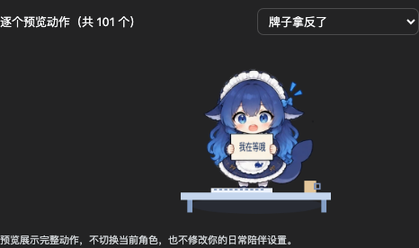
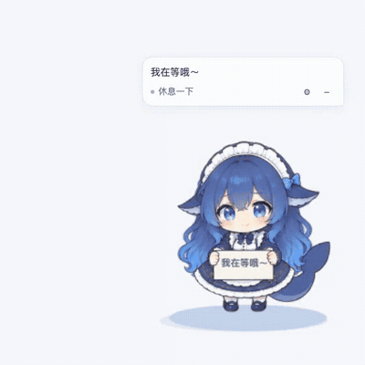
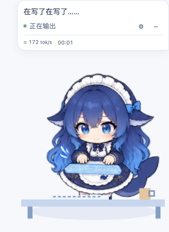
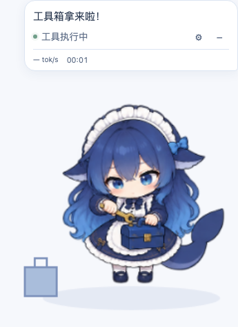
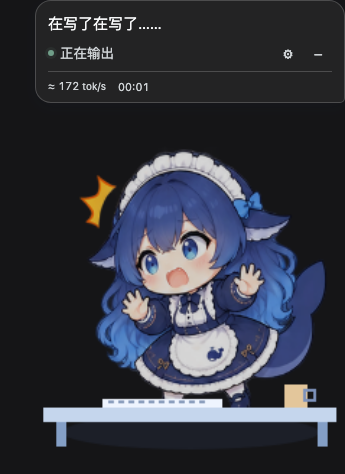
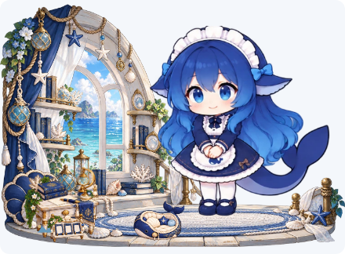
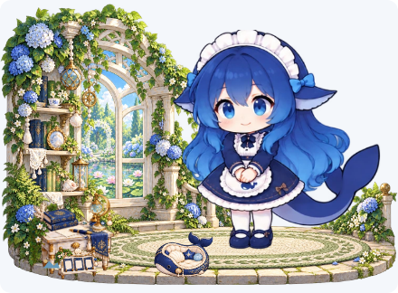

<div align="center">

# 🐋 大肥鱼 · DSH Bigfish

**让等待 Agent 工作的时间，多一只陪着你的大肥鱼。**

她会敲键盘、翻书、修工具、举牌等你，也会在任务结束时开心收工。<br>
**0.7 Web 预览版加入散步与回家、互动玩具和三套小窝。**<br>
一个装在 **DeepSeek Harness Web** 里的可拖动宠物，支持替换角色、制作动作和自定义台词。

[npm 安装](#快速安装) · [0.7 Web 预览版](#07-web-预览版) · [两分钟演示](#两分钟演示) · [制作自己的角色](#做一只属于你的宠物)

**活泼陪伴、随时安静 · 鞭策随时关闭 · 角色包自由替换**

</div>

## 快速安装

需要已经安装 **DeepSeek Harness（DSH）**，并使用它的 Web 界面。Bigfish 稳定版为 **`0.6.0`**，内置 **101 类动作**（原有 29 类 + 新增 72 段）。插件按宿主能力选择设置与会话桥接，不把 DSH 核心包带入插件。Node 要求 `^22.19.0 || >=24.0.0`。精确实测范围见[兼容性记录](docs/compatibility.md)。

直接从 npm 安装到你使用的 Web profile，无需下载源码或手动构建：

```sh
dsh plugin --profile web add dsh-bigfish
dsh --profile web
```

发布首日若仍装到旧版，请查看[刚发布版本的安装说明](docs/installation.md#刚发布的版本没有装上)：pnpm 11 默认有 24 小时发布冷却。

遇到未来不兼容的 DSH 时，大肥鱼会停在空闲状态，并在宠物气泡和完整设置中说明检测到的会话接口与升级建议；不会猜测任务状态。

打开或刷新 dsh-web，右下角就能找到她。`web` 请换成你的实际 profile 名称。

**插件里还附带 `dsh-bigfish-pet-maker` Skill，可用来制作、替换和扩展角色包。** 想启用它，再执行一次：

```sh
npx --yes dsh-bigfish install-skill
```

安装后新建 DSH 会话，即可让 Agent 使用 `$dsh-bigfish-pet-maker` 制作新角色或扩展动作，再从「完整设置 → 角色库」导入生成的 `.dshpet`。详见[角色制作示例](#做一只属于你的宠物)。

[详细安装、升级与卸载](https://github.com/gosomea/dsh-bigfish/blob/main/docs/installation.md) · [常见问题](https://github.com/gosomea/dsh-bigfish/blob/main/docs/faq.md) · [npm 包页面](https://www.npmjs.com/package/dsh-bigfish)

## 0.7 Web 预览版

**`0.7.0-next.1`** 新增网页内散步与回家、摸头、接球、三套小窝，以及可选的智能管家。新增 32 段八帧动作，与稳定版的 101 类动作分别统计。普通动作在本地运行，智能模式默认关闭。

```sh
dsh plugin --profile web add dsh-bigfish@0.7.0-next.1
dsh --profile web
```

[GitHub 预览版发布说明](https://github.com/gosomea/dsh-bigfish/releases/tag/v0.7.0-next.1) · [npm 版本页](https://www.npmjs.com/package/dsh-bigfish/v/0.7.0-next.1) · [功能与配置](#07-web-预览版功能与验收)

### 两分钟演示

[](https://github.com/gosomea/dsh-bigfish/releases/download/v0.7.0-next.1/dsh-bigfish-0.7.0-next.1-demo.mp4)

[打开或下载 MP4](https://github.com/gosomea/dsh-bigfish/releases/download/v0.7.0-next.1/dsh-bigfish-0.7.0-next.1-demo.mp4) · 2:00 · 1080p · 普通话旁白与中文字幕。画面来自插件预览，任务使用模拟数据，旁白使用 AI 合成。

## 72 段新动画，从等你到收工

新增动作直接加入 **大肥鱼 · 内置**，保留蓝发、鲸鱼尾巴与围裙标志，也保留原有 29 类动作。两批各 36 个设计共 **72 段新动画、432 个新绘制姿态**；升级后共 **101 类动作、18 种举牌演出**，无需另选角色。


> GIF 来自插件实际 Canvas 动作预览，按六个关键姿态采样；展示翻牌 → 分饼干 → 折纸鱼 → 找线索 → 画画 → 庆祝。任务演示没有调用模型，也没有录制聊天内容。

| 新动画系列 | 数量 | 可以看到的小剧场 |
| --- | ---: | --- |
| 举牌等你 | 13 | 牌子拿反了、尾巴当支架、气球托起牌、口袋里掏出小牌 |
| 日常陪伴 | 12 | 分你半块饼干、折纸鱼、梳尾巴、浇水草、织鲸鱼围巾 |
| 开工与思考 | 12 | 挽袖开工、便签打字、算盘推演、画路线图、蘸墨写草稿 |
| 工具执行 | 12 | 放大镜找线索、测试巡检、调色画画、小导演带队、多任务分篮 |
| 等待与任务结果 | 12 | 递来确认信、开心收工、交付小礼物、纸花庆祝、困惑排查 |
| 偶尔出现的彩蛋 | 6 | 小鲸鱼敬礼、转椅半圈、上发条鲸鱼、贝壳把戏、纸鱼船队 |
| 可关闭的空挥反应 | 5 | 先保住茶杯、收好尾巴、扶好眼镜、眨眼恢复打字 |

### 安装之后，怎样看到新动作？

1. 使用上面的普通 npm 安装命令；已有用户在任务空闲时重启 Host，再刷新网页。
2. 正在使用内置大肥鱼时，新动作自动参加轮转；已经选择的自定义角色与行为偏好继续保留。
3. 在「完整设置 → 角色库 → 大肥鱼 · 内置 → 预览」逐个查看 **101 类动作**。日常按任务状态、动作档位和互动频率选择演出。

举牌会拿出、举稳停留、再收好，适配 5–30 秒展示时长；气泡可以使用当前动作的专属台词。彩蛋至少间隔十分钟。想安静时仍可选择「安静陪着」或减弱动态；关闭鞭策后，五种空挥反应一并停用。

<table>
<tr>
<td align="center"><br><b>13 种举牌小剧场</b><br>不只站着等你</td>
<td align="center"><br><b>每个动作都能预览</b><br>原有与新增动作一起预览</td>
</tr>
</table>

[查看全部 72 个新动画](https://github.com/gosomea/dsh-bigfish/blob/main/docs/animation-gallery.md) · [0.6.0 稳定版说明](https://github.com/gosomea/dsh-bigfish/blob/main/docs/release-notes-0.6.0.md)

## 动画展示



> 本节 GIF 来自插件自带预览，使用实际宠物渲染与动画，任务和速度由演示数据驱动。大肥鱼是社区独立项目。

## 她会做什么？

| 当你…… | 大肥鱼会…… |
| --- | --- |
| 还没开始工作 | 按所选频率举牌、喝茶或休息；支持安静陪伴和自定义间隔 |
| 提交任务、等待首段输出 | 立即切换到工作准备状态，不再举着“我在等哦” |
| 看着模型输出 | 敲键盘、思考，跟随当前模型的相对速度调整节奏 |
| 让 Agent 读文件、搜索、执行工具 | 切换相应动作，在气泡里显示工具状态和可自定义的台词 |
| 需要确认或补充输入 | 停下来等你，不再催促输出 |
| 完成、取消或遇到错误 | 给出不同反馈；完成演出后回到休息 |

**不喜欢鞭策？关掉就好。** 齿轮里取消「启用鞭策动作」，鞭子及配套躲闪会一起关闭，正常工作动画继续。开启时只做非接触空挥，不会打到角色；默认静音。

## 先看看她

下面是宠物区域的使用截图，气泡、状态和控制按钮都是实际插件界面。

<table>
<tr>
<td align="center"><br><b>我在等哦</b><br>按你的频率举牌与休息</td>
<td align="center"><br><b>认真开工</b><br>气泡、速度和状态放在一起</td>
</tr>
<tr>
<td align="center"><br><b>工具也有动作</b><br>执行期间暂停空挥</td>
<td align="center"><br><b>夜里也陪着你</b><br>跟随明暗主题，鞭策可以关闭</td>
</tr>
</table>

**[▶ 观看 / 下载完整 MP4 录屏](https://github.com/gosomea/dsh-bigfish/blob/main/docs/media/bigfish-demo.mp4)**：举牌 → 工作 → 速度变化 → 调用工具 → 等待确认 → 完成 → 关闭鞭策 → 深色模式。无需声音也能看懂。

### 原有动作继续保留

原有 **29 类动作、72 个绘制姿态、6 个场景、5 种举牌演出**继续保留，与新动作一起轮转。阅读、工具操作、打字、等待确认等使用连续图像帧；部分动作结合程序位移与场景道具。这里的 72 个原版姿态，与上面的 72 段新增趣味动画是两套不同素材。

最近精修了喝茶、擦汗和伸懒腰，让动作有准备、过程和收尾：


动作可以在「完整设置 → 角色库」逐个预览，内置大肥鱼也支持。

## 按你的习惯陪伴

- **想让她多说几种话**：内置 **20 类 × 8 句，共 160 句**可编辑台词，覆盖思考、输出、各类工具、等待确认和任务结束。支持 `{task}`、`{tool}`、`{file}` 等变量；已有自定义内容优先，想用新版可在该类别点“恢复这一类默认”。[完整台词库](https://github.com/gosomea/dsh-bigfish/blob/main/docs/default-dialogue.json)
- **想看更多互动**：默认「活泼陪伴 + 活泼」，每次动作展示 12 秒后休息 5–10 秒；气泡最多 6 秒，举牌会在举稳时停留再放下。工作空挥后保持恢复姿态 2.5 秒。旧模式选择保留，0.5.3 的频率按新的休息间隔计算。
- **想安静一点**：选择「安静陪着」，首次问候后不反复举牌、换台词。空闲互动、动作表现和说话频率分别控制。
- **想热闹一点**：选择「持续活动」，或自定义 1–600 秒休息间隔；可选「多举牌／均衡轮换／不举牌」，每次展示时长可调 5–30 秒。浮层设置显示当前状态和下一次互动倒计时。
- **不喜欢鞭策**：关闭「启用鞭策动作」。设置会保存，刷新或换角色后继续生效。
- **挡住内容了**：拖动宠物或气泡换位置；点 `−` 收起为图标，图标同样可以拖动。支持调整大小和透明度。
- **想换句台词**：在「自定义台词与工具」编辑工作、等待、完成等台词，给工具名称或前缀配置专属规则。
- **想换设备**：「完整设置 → 备份与恢复」导出角色、偏好、台词和编排。导入时先检查并预览，再确认恢复。

**不同模型，不用同一把尺子。** 自动模式按 provider、model、推理配置和统计通道分别学习速度，适配约 20～400 tok/s 等不同量级。显示的 `≈ tok/s` 是估算值；工具等待、首段等待不会简单算成“输出太慢”。可选择“慢了催一催”或“跟着输出节奏动”，也可手动设定目标。

**多个会话同时工作时，跟随你当前打开的会话。** 不叠加后台速度，后台完成不会抢走前台状态；当前会话空闲时，宠物也保持空闲。刷新历史记录不会重播庆祝。

[陪伴与设置说明](https://github.com/gosomea/dsh-bigfish/blob/main/docs/settings-v2.md) · [台词与工具扩展](https://github.com/gosomea/dsh-bigfish/blob/main/docs/dialogue.md) · [备份与恢复](https://github.com/gosomea/dsh-bigfish/blob/main/docs/backup-and-storage.md)

## 做一只属于你的宠物

Bigfish 支持可替换的 **`.dshpet` 角色包**。角色包可以有比内置大肥鱼更多的动作，自定义动作 ID、标签、连续帧、台词和道具，不需要修改插件代码。

1. 在「完整设置 → 角色库」导入 `.dshpet` 或兼容 ZIP。
2. 先预览角色和每个动作，再安装并使用。
3. 切换角色时保留你的陪伴偏好；已安装版本可保留并切换。

Release 另附 **大肥鱼 · 成年版**：沿用原始鲸鱼女仆形象，保留尾巴与围裙标志，包含 8 组动作。

### 用一个 Skill 和 Agent 一起做角色

npm 包已经包含完整 Skill，不必另下 ZIP：

```sh
npx --yes dsh-bigfish install-skill
```

默认安装到 `$DSH_HOME/skills/dsh-bigfish-pet-maker`；未设置 `DSH_HOME` 时使用 `~/.dsh/skills/dsh-bigfish-pet-maker`。已有相同内容会跳过，不同内容会保留并提示，不会覆盖你的修改。安装 Skill 后请新建 DSH 会话；宠物插件本身的安装不会自动修改技能目录。

其他 Agent 可使用 `npx --yes dsh-bigfish install-skill --skills-dir /absolute/path/to/agent/skills` 指定技能目录。也保留 [独立 Skill ZIP](https://github.com/gosomea/dsh-bigfish/releases/download/v0.6.0/dsh-bigfish-pet-maker-0.6.0.zip) 供手工安装。具体宿主的技能目录和发现方式请以其配置为准。

然后直接和 Agent 说：

> 用 $dsh-bigfish-pet-maker 做一只蓝色小狐狸。平时安静，工作时认真。设计打字、读书、搜索、执行工具、等确认、举牌和完成庆祝，再加一些狐狸自己的小动作。交付能导入 DSH 的角色包和预览。

也可以给现有角色加动作：

> 用 $dsh-bigfish-pet-maker 扩展这个角色包，增加喝茶、整理文件和测试完成的动作。保持角色外观一致，保留原有动作，升级角色包版本。

Skill 包含模板、校验器、素材组装、离线预览和打包工具。生成新美术需要 Agent 自身具备图像生成能力；也支持使用已有素材。角色包遵守文件、像素和帧数量上限，加载时不会执行包内脚本或请求远程素材。

[角色包使用指南](https://github.com/gosomea/dsh-bigfish/blob/main/docs/pet-pack/user-guide.md) · [角色包协议](https://github.com/gosomea/dsh-bigfish/blob/main/docs/pet-pack/spec.md) · [Skill 源码](https://github.com/gosomea/dsh-bigfish/blob/main/skills/dsh-bigfish-pet-maker/SKILL.md)

## 从源码运行

```sh
git clone https://github.com/gosomea/dsh-bigfish.git
cd dsh-bigfish
pnpm install --frozen-lockfile
pnpm build
pnpm preview
```

打开 `http://127.0.0.1:4178`。构建也会生成 `dist/preview.html`以及成年版等角色包。

检查与打包：

```sh
pnpm check
pnpm test
pnpm exec playwright install chromium
pnpm test:browser
pnpm pack --pack-destination dist
python3 scripts/package-release.py
```

Node `^22.19.0 || >=24.0.0`，pnpm `11.7.0`。原生接入探针需要另行准备已构建的 DSH 源码；详情见 [兼容性与验证](https://github.com/gosomea/dsh-bigfish/blob/main/docs/compatibility.md)。录屏复现方法见 [媒体说明](https://github.com/gosomea/dsh-bigfish/blob/main/docs/media/README.md)。

## 验证与边界

`0.6.0` 在 macOS Apple Silicon / Node 24.19.0 完成 **151 项单元测试、34 项 Chromium 浏览器回归、DSH `0.2.0-rc.2` 的 15 组隔离原生流程**；覆盖内置 101 类动作预览、角色切换、设置持久化、实时任务、并发会话、备份与卸载。原生任务使用本地无密钥流式提供器，没有付费模型调用。旧版 DSH、Linux arm64 和约 30 分钟渲染检查属于此前版本的历史验证，详见兼容性记录。

这不代表所有平台都已支持：Windows、x86、Safari / Firefox、网络共享文件系统及跨天运行尚未完成验证。共享同一 `DSH_HOME` 的多个实例需要全部升级到支持跨进程锁的版本。备份恢复包含冲突保护与回滚，但跨 Host 和浏览器存储不构成一个整体原子事务。

[验证范围](https://github.com/gosomea/dsh-bigfish/blob/main/docs/compatibility.md) · [五项优化审查](https://github.com/gosomea/dsh-bigfish/blob/main/docs/review-0.5.0.md) · [架构](https://github.com/gosomea/dsh-bigfish/blob/main/docs/architecture.md) · [动作设计](https://github.com/gosomea/dsh-bigfish/blob/main/docs/scene-packs.md) · [速度自适应](https://github.com/gosomea/dsh-bigfish/blob/main/docs/adaptive-speed.md)

## 许可与素材

代码采用 [MIT](https://github.com/gosomea/dsh-bigfish/blob/main/LICENSE)。角色美术和标志另见 [NOTICE](https://github.com/gosomea/dsh-bigfish/blob/main/NOTICE) 与 [素材来源](https://github.com/gosomea/dsh-bigfish/blob/main/docs/asset-provenance.md)：原始参考图作者尚未确认，代码许可不代表对第三方角色或商标权利的授权。本仓库不包含用户原始参考截图、聊天记录或模型凭据。

测试范围、可执行门禁和未验收项见 [验证说明](docs/verification.md)。

## 0.7 Web 预览版功能与验收

新增 **32 段八帧序列（256 帧）**。大肥鱼可以先起步再散步，在边缘停下、探头、护住尾巴再坐下。普通动作有收尾，重要提醒和直接互动能立即接管。

任务状态、工具动作和 32 段八帧素材见[动作与状态索引](docs/animation-states.md)。

- **更有生活感**：摸头、喂食、玩具、装扮、真实互动成长与解锁、明确标注虚构的季节故事，以及招手 → 传球 → 茶点 → 告别的本地双宠链。
- **三套手绘小窝**：浅海、月夜、花园；家具与角色共用落脚平面，小床、书桌、灯可分别开关。灯光、水纹、花瓣和喝茶时的蒸汽按角色状态变化；安静、减弱动态、打开设置或页面不可见时暂停环境动画。
- **可选智能管家**：多会话任务本、有限的工具执行事实与公开结果短摘、来源记忆、共享预算和额度不足提醒。智能默认关闭，启用后额外消耗模型 token；普通陪伴不调用模型。工具成功不会被当作整个任务完成，详情见[理解范围](docs/intelligent-pet.md#智能理解的范围)。
- **陪伴优先的设置**：新安装默认「持续活动」，每段空闲动作完整播放后休息 1–3 秒。齿轮面板提供安静 30 分钟、活跃程度、活动范围、场景和鞭策开关。喂食和玩具收在「一起玩」。完整设置分为日常陪伴、智能管家、外观与生活、高级与数据。消息显示与说话频率独立设置。举牌、生活与散步轮流安排。命名方案可保存外观与行为偏好，模型授权与预算另行管理。下拉菜单跟随 DSH 明暗主题，支持键盘和屏边避让。牌面文字自动换行，超出时省略。
- **自由活动与纯宠物显示**：首页可隐藏背景与环境布景，保留人物、牌子及动作自带道具，原有小窝布置不变。“全屏自由活动”沿二维路线播放真实步态；网页限制在当前可见区，桌面限制在当前显示器工作区，碰到边缘停步，工作和拖动优先。普通动画与移动不调用模型。
- **独立桌面开发版**：与网页共享角色及外观，支持跨屏开关、窗口几何授权、按住录音与用户配置的转写服务。真实硬件、Windows 实机、签名与 macOS 公证仍须验收，不能当正式全能版分发。

<table><tr>
<td></td>
<td></td>
<td></td>
</tr></table>

上图是本地素材的静态合成检查，只截宠物舞台；不代表真实会话、模型或动态演示。**全能型标为“预览版”**，功能状态按当前角色、Host、设备和配置分别显示；选择全能型不会代为开启模型或系统权限。伙伴可选内置大肥鱼、当前主角色或本 Host 已安装的角色；每次邀请一名，素材与成长条件不足时不启动。活动区域与回家落脚点只保存在本设备，不随陪伴方案导入；智能管家可查看任务、工具、提醒和记忆的来源时间线。 [功能与费用](docs/intelligent-pet.md) · [素材记录](assets/intelligent-pet/README.md) · [开发状态与验收边界](docs/plans/intelligent-pet/implementation-status.md)。

角色包新能力与独立 **dsh-bigfish-pet-maker 1.1.0** 已同步，支持任意扩展动作、生活／双宠映射和装扮锚点；这些新增声明面向开发版，制作前请核对 Host 插件版本。
